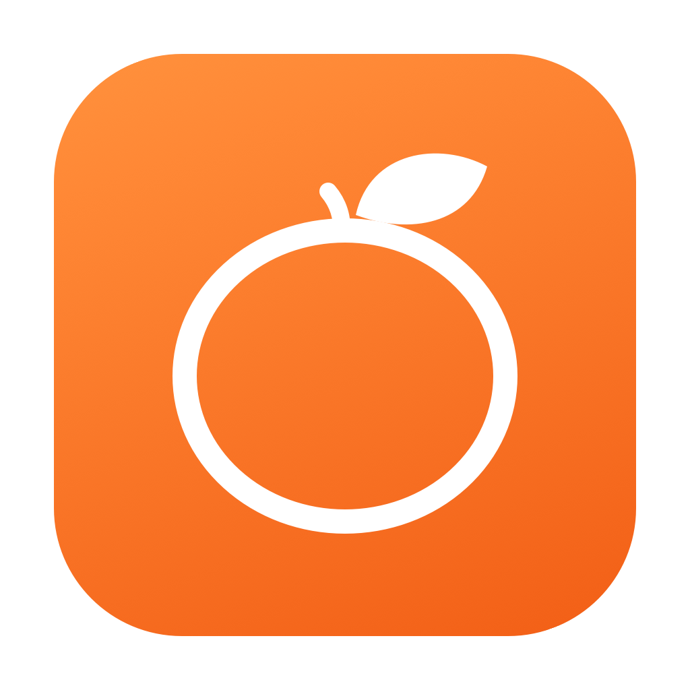
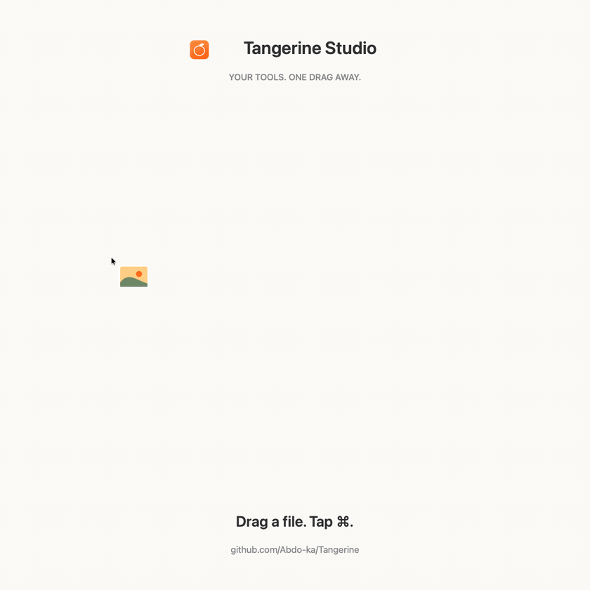

# Tangerine Studio



A native macOS workspace for converting and working with files, entirely offline.
Built with SwiftUI, AppKit, Apple Vision, FFmpeg, LibreOffice and a local Python
conversion engine.

**Status: early contributor release (0.1.1).** The app builds and has real conversion
implementations and integration tests. It is not yet a certified feature-for-feature
replacement for the commercial app. See [capabilities and limits](docs/FEATURES.md)
and the [release checklist](docs/RELEASING.md).

This is an independent implementation inspired by the workflow at
[tangerineformac.com](https://tangerineformac.com). It is not affiliated with that
product. No proprietary source code, artwork or binaries from it are included.

## Tools wheel



## What you can do

- Convert images, audio, video, PDFs, documents, slides, spreadsheets, EPUBs,
  subtitles and archives.
- Use 28 tools: compression, cropping, resizing, background removal, photo adjustments, annotation, redaction,
  backgrounds, collages, PDF creation/merge/split/organization, audio normalization,
  trimming, channel conversion, visualizers, video joining/splitting/snapshots,
  speed adjustment, metadata editing and archive extraction.
- Process batches, set an output folder, keep originals, see errors and reveal results.
- Drag files in Finder and tap Shift for formats, Command for tools, or Control for
  actions. Drop on a wheel option.
- AirDrop, float files on a shelf, copy, move, copy paths and open Terminal.
- Extract scanned PDF text locally using Apple Vision.

## Downloads

Download **[Tangerine-Studio.dmg](https://github.com/Abdo-ka/Tangerine/releases/latest)** from GitHub Releases.
Open it and drag Tangerine into the Applications shortcut inside the wheel.
Licenses remain inside the app bundle.

The published installer requires **Apple silicon and macOS 14 or later**. It is
ad-hoc signed and not notarized; Gatekeeper may block launch. The dependency-source
audit and clean-machine checks remain incomplete. See the [release checklist](docs/RELEASING.md).
No Intel installer is provided.

## Requirements

- Apple silicon Mac; native UI source targets macOS 14 or later.
- Xcode 15+ or compatible Swift toolchain; Python 3.13; Homebrew for FFmpeg.
- LibreOffice for office layout conversion. Apple Pages for `.pages` import/export.
- Disk space for the Python environment and bundled office/media engines.

## Quick start

```sh
git clone https://github.com/Abdo-ka/Tangerine.git
cd Tangerine
scripts/bootstrap.sh --with-office
swift run
```

Alternatively open `Package.swift` in Xcode. `swift run` uses `.venv` and tools on
PATH. The build script produces a self-contained local app with the Python runtime,
FFmpeg/FFprobe and LibreOffice:

```sh
scripts/build-app.sh
open dist/Tangerine.app
```

The packaged minimum macOS version is audited from its actual native libraries
and recorded in `Contents/Resources/deployment-targets.json`. The local preview
built with current Homebrew libraries requires macOS 26; builds made with older
compatible tools can target older systems.

The download includes the offline office, media and Python engines. LibreOffice
is the largest component. Installer builds use LZMA compression; download size
varies with the exact engine versions. Installing the app expands those engines.

The package is ad-hoc signed for local testing. Developer ID signing and Apple
notarization are separate release steps. Pages is an external Apple application;
macOS asks for Automation permission when you first use it.

## Verify

```sh
swift test
.venv/bin/python -m unittest discover -s Tests/Python -v
```

Tests generate small files in temporary directories and do not use personal files
or upload anything. See [CONTRIBUTING.md](CONTRIBUTING.md) for the manual UI matrix.

## Use

1. Drop files into the window or press **⌘O**. Move files up to change batch order.
2. Choose a conversion format, a file tool, or a file action. Right-click a format
   for quality, PDF-password or EPUB-layout options. Return opens the keyboard menu.
3. Tool windows let you set parameters and preview the source. For image region
   tools and videos, drag over the preview to choose a region. Audio offers waveform
   range handles; PDFs offer page thumbnails.
4. Outputs are new files beside the originals unless you choose another folder.
   Recent activity shows success, failure, and output links.

A PDF/image export with multiple pages creates a folder. PDF-to-PowerPoint uses
page images; PDF-to-Word is text reconstruction, not guaranteed layout recovery.
Changing formats can lose information that the destination format cannot represent.

## Project guide

- [AGENTS.md](AGENTS.md): coding-agent and contributor working rules
- [Architecture](docs/ARCHITECTURE.md)
- [Feature matrix](docs/FEATURES.md) · [Observed verification results](docs/VERIFICATION.md)
- [Worker API and options](docs/ENGINE.md)
- [Contributing](CONTRIBUTING.md) · [Security](SECURITY.md) · [Releasing](docs/RELEASING.md)
- [Third-party notices](THIRD_PARTY_NOTICES.md) · [Changelog](CHANGELOG.md)

## License

Project code is licensed under **AGPL-3.0-or-later**; see [LICENSE](LICENSE).
Bundled dependencies retain their own licenses. FFmpeg builds with GPL codecs and
PyMuPDF require particular care when distributing modified binaries; the release
process includes corresponding-source and notice requirements.
